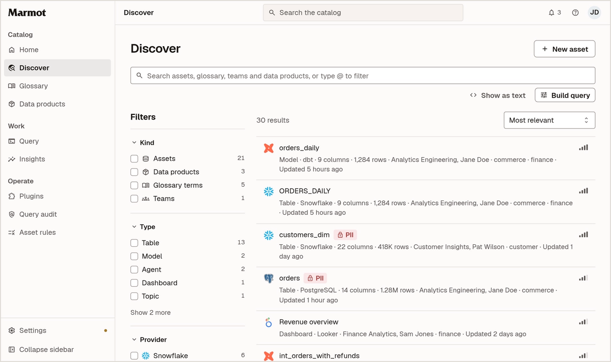
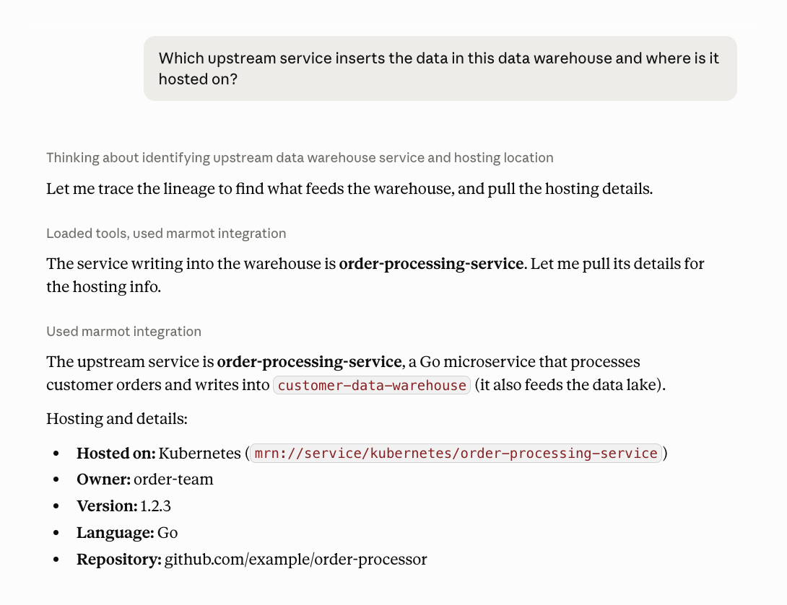

<p align="center">
  
  &nbsp;&nbsp;
  <picture>
    <source media="(prefers-color-scheme: dark)" srcset="./web/docs/static/img/marmot-wordmark-paper.svg">
    
  </picture>
</p>

<p align="center">
  <strong>One governed way in to your data, for people and AI agents.</strong>
</p>

<p align="center">
  Marmot catalogs your tables, topics, dashboards and pipelines with 70+ plugins, records their lineage, owners and definitions,
  and lets people and agents query the data through it, with every query checked and audited.<br>
  Use it from the web UI, the CLI, the SDKs or its built-in MCP server. It runs as one Go binary backed by PostgreSQL.
</p>

<p align="center">
  <a href="https://marmotdata.io/docs/quick-start">Quick start</a> ·
  <a href="https://marmotdata.io/docs/introduction">Documentation</a> ·
  <a href="https://plugins.marmotdata.io">Plugins</a> ·
  <a href="https://cloud.marmotdata.io/signup">Marmot Cloud</a> ·
  <a href="https://discord.gg/TWCk7hVFN4">Discord</a>
</p>

<picture>
  <source media="(prefers-color-scheme: dark)" srcset="./web/docs/static/img/readme-tour-dark.webp">
  
</picture>

## What you can do with it

Marmot catalogs the tables, topics, dashboards and pipelines you already run, records what each one means and who owns it, and serves that context to everyone from one place:

- **Search every source** in plain words, then narrow the results with the [query language](https://marmotdata.io/docs/queries).
- **Trace lineage** upstream and downstream, from plugins and [OpenLineage](https://marmotdata.io/docs/open-lineage) runs, before you change something. See [lineage](https://marmotdata.io/docs/lineage).
- **Explain what data means** with owners, descriptions, a [glossary](https://marmotdata.io/docs/glossary) and [data products](https://marmotdata.io/docs/data-products) that travel with every asset.
- **Give agents the same context** through the [MCP server](https://marmotdata.io/docs/MCP), the CLI and SDKs for Go, Python and TypeScript.
- **Run SQL through Marmot** against the sources you connect. Each query is checked against the caller's roles and recorded in the [query audit](https://marmotdata.io/docs/query-audit), so an agent never needs a database password of its own.
- **Keep it current** with [70+ plugins](https://plugins.marmotdata.io) for systems such as PostgreSQL, BigQuery, Kafka, dbt and Airflow, or declare assets yourself with [Terraform](https://marmotdata.io/docs/Populating/Terraform) and the [API](https://marmotdata.io/docs/Populating/API).

## Try it locally

You need Docker with Docker Compose, and port 8080 free. Save this as `docker-compose.yaml`. It's for trying Marmot out, so it stores credentials unencrypted:

```yaml
services:
  marmot:
    image: ghcr.io/marmotdata/marmot:latest
    ports:
      - "8080:8080"
    environment:
      MARMOT_DATABASE_HOST: postgres
      MARMOT_DATABASE_PORT: 5432
      MARMOT_DATABASE_USER: marmot
      MARMOT_DATABASE_PASSWORD: marmot
      MARMOT_DATABASE_NAME: marmot
      MARMOT_DATABASE_SSLMODE: disable
      MARMOT_SERVER_ALLOW_UNENCRYPTED: true
    depends_on:
      postgres:
        condition: service_healthy

  postgres:
    image: postgres:16-alpine
    environment:
      POSTGRES_USER: marmot
      POSTGRES_PASSWORD: marmot
      POSTGRES_DB: marmot
    volumes:
      - marmot_data:/var/lib/postgresql/data
    healthcheck:
      test: ["CMD-SHELL", "pg_isready -U marmot"]
      interval: 5s
      timeout: 5s
      retries: 5

volumes:
  marmot_data:
```

Start it:

```bash
docker compose up -d
```

Open [http://localhost:8080](http://localhost:8080) and sign in as `admin` with the password `admin`. Marmot asks you to choose a new password, then you can open **Plugins** and pick a system under **Add a source** to catalog it. The [quick start](https://marmotdata.io/docs/quick-start) walks through the first pipeline.

To skip running it yourself, [Marmot Cloud](https://marmotdata.io/docs/Cloud/getting-started) launches a managed instance. The free plan needs no card.

## Connect an agent

Create an API key under **Account → API keys**, then add Marmot to your client's MCP configuration. For Claude Code, that's `.mcp.json` in your project's root:

```json
{
  "mcpServers": {
    "marmot": {
      "type": "http",
      "url": "http://localhost:8080/api/v1/mcp",
      "headers": {
        "X-API-Key": "<api-key>"
      }
    }
  }
}
```

The agent can then search the catalog, trace lineage and look up owners and glossary terms, with the same permissions as the key it uses:

<picture>
  <source media="(prefers-color-scheme: dark)" srcset="./web/docs/static/img/readme-agent-lineage-dark.png">
  
</picture>

The [MCP docs](https://marmotdata.io/docs/MCP) cover Claude Desktop, Cursor, Cline and LibreChat. [Marmot for agents](https://marmotdata.io/docs/Agents) covers skills, LangChain and the Claude Agent SDK.

## Work from your terminal

The `marmot` CLI searches the catalog, manages assets and runs the server. Install it with Homebrew:

```bash
brew install marmot
```

Or with the install script:

```bash
curl -fsSL get.marmotdata.io | sh
```

See the [CLI reference](https://marmotdata.io/docs/cli) for every command.

## Run it for your team

The core is open source under the MIT licence and runs anywhere you can run a container or a binary. [Self-host](https://marmotdata.io/docs/Deploy) covers Docker Compose, Docker, Helm and the binary, with an encryption key for stored credentials. [Marmot Cloud](https://marmotdata.io/docs/Cloud) runs it for you and adds access control per resource, secret stores and keyless pipelines. The data model, query language, plugins and MCP server are the same in both.

## Get help

- [Discord](https://discord.gg/TWCk7hVFN4) for questions and talking to the team and other people running Marmot.
- [GitHub issues](https://github.com/marmotdata/marmot/issues) for bugs and feature requests.
- [Report a vulnerability](https://marmotdata.io/security) privately, not in an issue.

## Contributing

Read the [contributing guide](CONTRIBUTING.md) before you open a pull request. [Local development](https://marmotdata.io/docs/Develop/local-development) gets Marmot running from source, and [build a plugin](https://marmotdata.io/docs/Develop/creating-plugins) covers connecting a system that has no plugin yet.

## Licence

Marmot is open source under the [MIT licence](LICENSE).
